[← Teardown log](../teardown-log.md) · **Step 2 of 6: Teardown** · [Overview](../../README.md)

# Selected screenshots

13 of the 91 screenshots from my walkthrough, chosen because the PRD relies on them. Each was checked before publishing: no names, balances or account details; my account initials on S01 are blurred. S numbers match the [teardown log](../teardown-log.md). Click any image for full size.

## The Invest tab and a single stock

| S01 · Invest tab | S26 · Free-trade banner | S27 · "Revolut Suggestion: Buy" | S34 · Order confirmation |
| --- | --- | --- | --- |
| [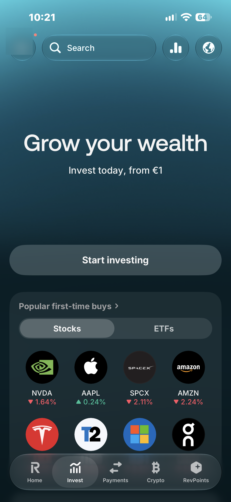](S01_invest-tab-top.png) | [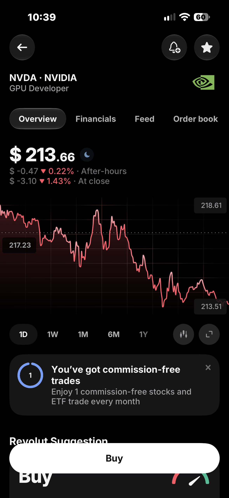](S26_free-trade-banner.png) | [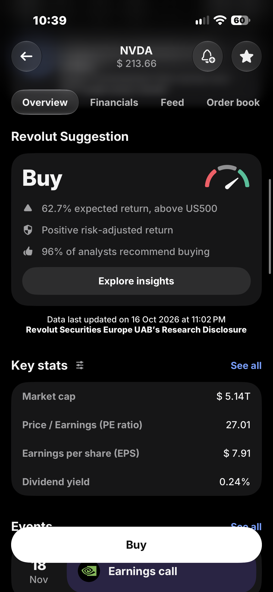](S27_buy-suggestion.png) | [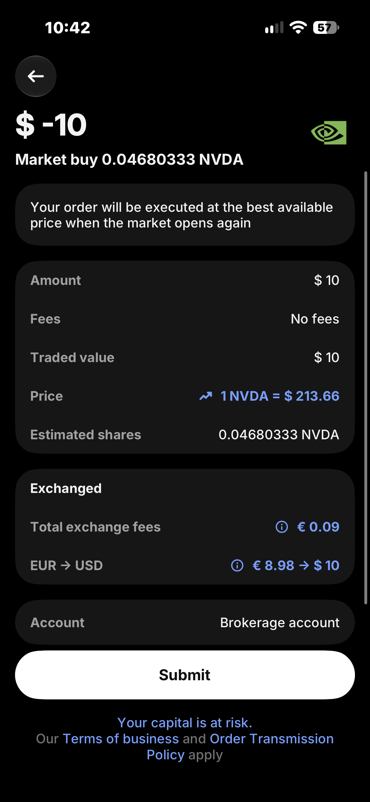](S34_order-confirmation.png) |
| Single stocks lead; "from €1" | 1 free trade a month on Standard | A buy signal on a single stock | Costs shown before Submit |

## The ETF hub

| S38 · No-commission ETFs | S38 · Index and technology ETFs | S38 · Crypto and leveraged products |
| --- | --- | --- |
| [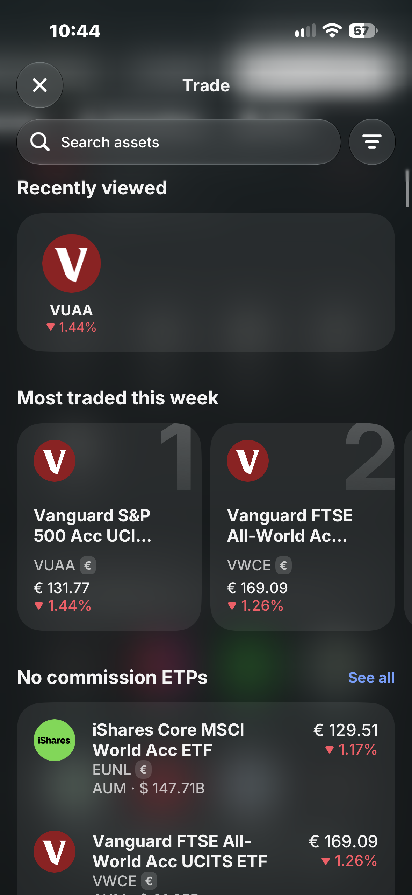](S38_etfs-etps-no-commission-list.png) | [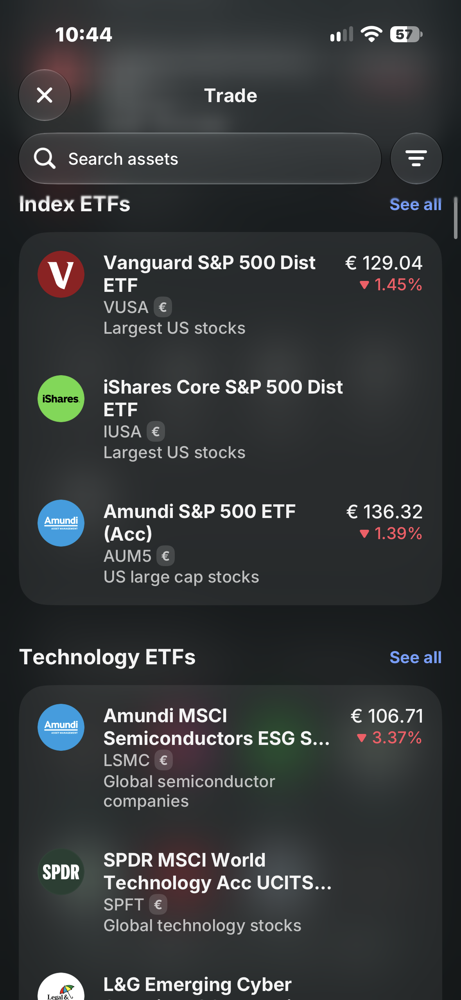](S38_index-etfs-and-technology-etfs.png) | [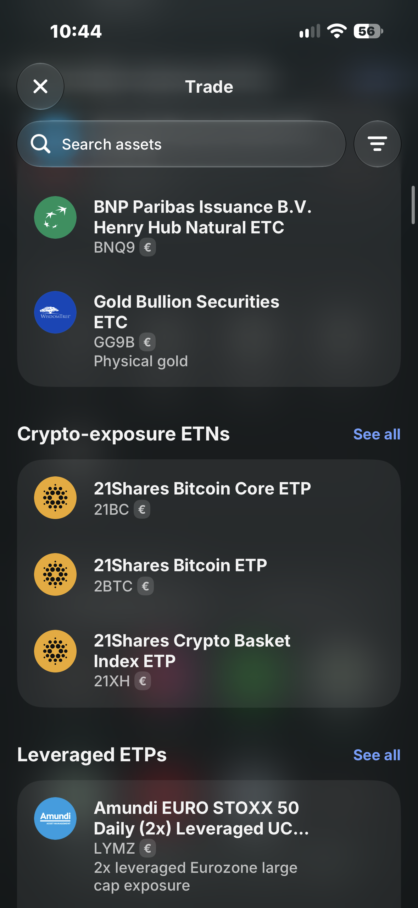](S38_commodity-etcs-crypto-etns-leveraged.png) |
| Broad index funds, three taps deep | Several S&P 500 funds listed | On the same page as the index funds |

## Searching "S&P 500" (captured Oct 19, after the interviews)

| S40 · Results | S41 · CFDs in results | S42 · Help links | S43 · Fund page | S44 · Key stats | S45 · About and KID |
| --- | --- | --- | --- | --- | --- |
| [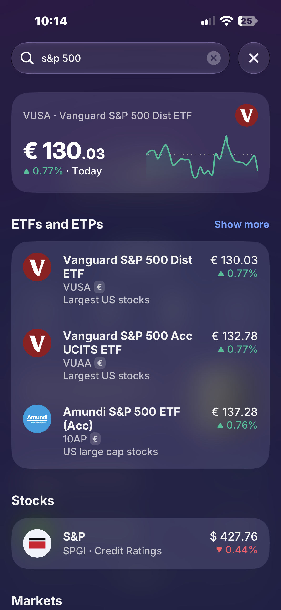](S40_search-sp500-etf-results.png) | [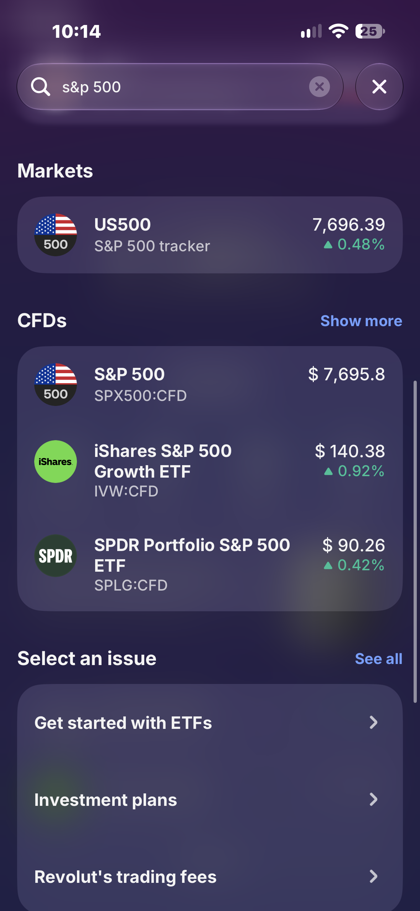](S41_search-sp500-markets-and-cfds.png) | [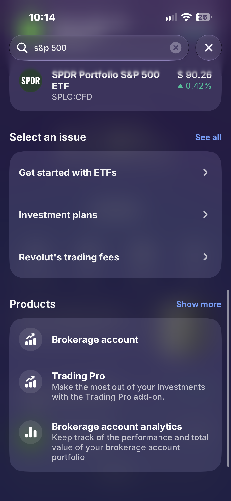](S42_search-sp500-help-links-and-products.png) | [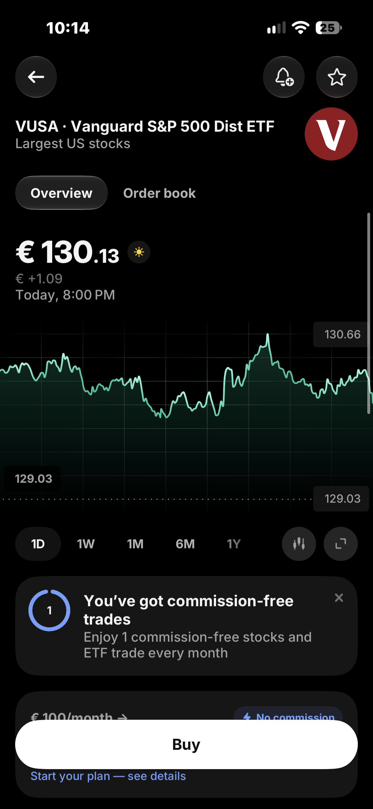](S43_vusa-page-top-free-trade-banner.png) | [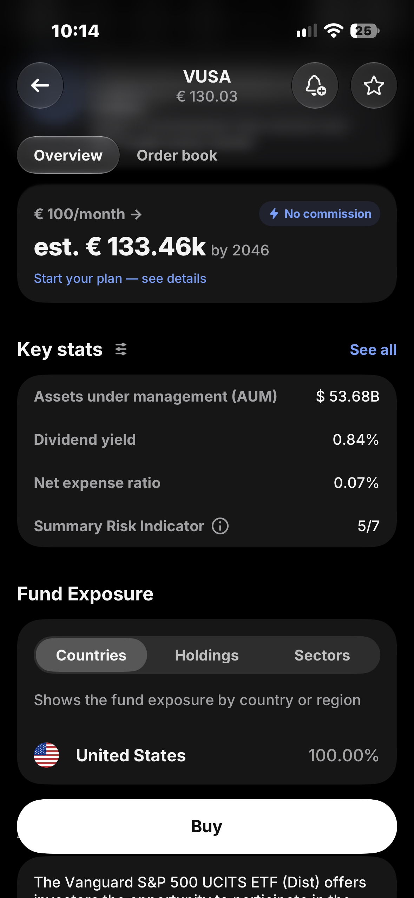](S44_vusa-plan-teaser-and-key-stats.png) | [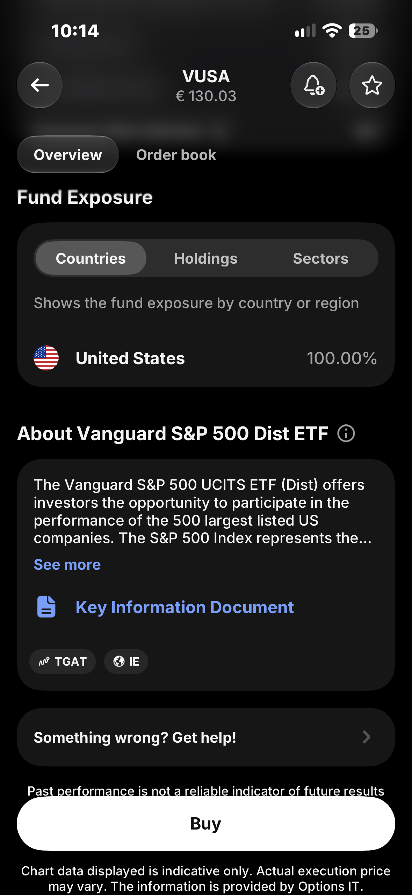](S45_vusa-about-and-key-information-document.png) |
| Three funds, one index | Near-identical CFD names | Below everything else | Free-trade banner again | Cost, size, risk score | Risk text at the bottom |

The annotated version of S40 is in the [overview](../../README.md#3-the-screen-where-they-stalled).

---

[← Teardown log](../teardown-log.md) · Next: [Interview guide →](../../03-research/interview-guide.md)
