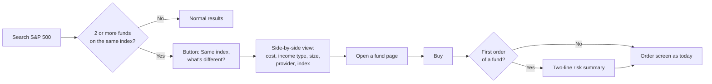

[← PR/FAQ](../04-prfaq/prfaq.md) · **Step 5 of 6: PRD** · Next: [Deck →](../06-deck/)

# PRD: Helping students choose their first long-term fund

| | |
| --- | --- |
| **Author** | Muhammad Ghazwan |
| **Status** | v1.1 draft, Mon Oct 19, 2026 |
| **Decisions** | G1 scope (students) · G2 problem · G3 metric and non-goals: all decided by the author, Oct 19 ([decision log](../01-scope/brief.md#decision-log)) |
| **Reviewers in a real team** | Design, mobile engineering, data science, compliance, legal (not reviewed: independent project) |
| **Related** | [PR/FAQ](../04-prfaq/prfaq.md) · [Synthesis](../03-research/synthesis.md) · [Teardown log](../02-teardown/teardown-log.md) · [Miro board](https://miro.com/app/board/uXjVEYcX4L0=/) |

**This is an independent student teardown and proposal, not a Revolut document.** Evidence labels: **Primary** = own app walkthrough (Oct 18 to 19) and six interviews (Oct 19). **Secondary** = public sources, date checked. Targets are proposals; baselines are "to be measured".

---

## TL;DR

- **Problem:** students who want a long-term index fund search for it, see several near-identical funds (three S&P 500 funds today), cannot tell them apart, and stall or leave the app.
- **Evidence:** 5 of 6 students struggled with this choice; 2 of the 2 who had never invested left without buying at that exact screen.
- **Insight:** the app already holds every fact needed to compare (cost, size, risk indicator); it just sits on separate pages.
- **Proposal:** a neutral "Same index, what's different?" view plus a two-line risk summary before the first order. No ranking, no advice.
- **Success:** more first orders for a broad index fund within 7 days, without more trading or riskier buying among first-timers.

## 1. Problem and evidence

**Job statement.** When I'm a student with a small amount of spare money and want to start investing for the long term, I want to tell which of several near-identical funds is the right one, and what risk I'm taking, so I can buy with confidence without spending hours researching somewhere else.

**From the interviews (Primary, n = 6 students).**

- 5 of 6 found it hard to choose between near-identical funds or to understand what they were buying and the risk. 3 raised it before being shown anything.
- Both students who had never invested (P4, P6) searched "S&P 500", saw several similar results, could not tell them apart, and left to research elsewhere without buying. 2 more (P2, P3) avoided or delayed buying a fund for the same reason.
- Searching and ordering worked for everyone who tried. The stall sits between "I know what I want" and "I am sure I picked the right one".
- In their words: "The problem wasn't finding products. It was knowing how to choose between them." / "I didn't want to pick one randomly."
- What did **not** hold up: fees surprising people (nobody was), the free-trade allowance (many did not know it, none harmed), onboarding length (heavy for some, nobody quit), and funds being hard to find (people used search).

**From the app (Primary, walkthrough).**

- Searching "s&p 500" returns three funds on the same index: Vanguard S&P 500 **Dist** (€130.03), Vanguard S&P 500 **Acc** (€132.78) and Amundi S&P 500 **Acc** (€137.28). Each row shows only name, ticker, price, daily move and a three-word description. Nothing says they track the same index or what differs (S40).
- The same results list CFD versions of S&P 500 ETFs with near-identical names and an unrelated stock called "S&P". A "Get started with ETFs" help link sits below all of them (S40 to S42).
- **What already works:** each fund page shows assets under management, dividend yield, net expense ratio, a Summary Risk Indicator (5/7 for the Vanguard fund), country exposure and a Key Information Document link (S44, S45). The gap is **not missing data**; it is that comparing means opening each page and holding the numbers in your head, which is what P6 described.
- The order confirmation already shows costs before Submit (S34). The Invest front page leads with single stocks, top movers and a Buy suggestion (S01 to S03, S27).

**What is not proven.** Six young students, five on Revolut, two in a finance society, one researcher. The screen task named a concrete task, and for two people the finding appeared only there. P4 and P6 only knew "S&P 500" by name, so the search term shapes what they saw. Interviews 3 to 6 were voice-recorded and transcribed with an AI tool, then checked by the author. Early evidence, not proof.

## 2. Why now and why it matters

- Revolut rolled out zero-commission ETF investment plans in the EEA and grew Wealth revenue 31 percent to $876m in 2025 (Secondary, 2025 annual results, March 2026). Cheap broad funds are now within reach; the remaining barrier is the choice.
- More than 63 percent of Revolut's new retail customers joined through word of mouth or referral (Secondary, same source). Our interviewees also started because of friends and social media, and arrive knowing one index name, not a fund.
- **Hypothesis, not measured:** a confident first fund purchase leads to repeat investing and a longer customer relationship, while a stalled first attempt pushes students toward news-driven single stocks (seen in P1, P2).

## 3. Users and scope

- **Who:** students (about 18 to 25) in the Netherlands and the EEA who are first-time or early-stage investors. In the sample: 2 never invested, 2 started recently, 2 invest regularly.
- **In scope:** from searching or opening a broad index fund to a first order they feel confident about.
- **Out of scope:** account opening, fees, the free-trade allowance, robo-advice, recurring buy, single-stock discovery, CFDs and bonds.

**User stories**

1. As a student who has never invested, when I search "S&P 500" and see three funds, I want to see what makes them different in plain words, so I can pick one without leaving the app.
2. As a student about to place my first order, I want to know in two lines what I could lose and how I take money out, so I am not afraid of a mistake I don't understand.
3. As a student who already invests, I want to compare cost and income type quickly, so I don't have to open each fund page.

## 4. Goals and non-goals

**Goals**

1. More students who want a long-term fund make a first purchase they feel confident about.
2. Students can say in their own words what separates two funds on the same index, and what risk they take.
3. First-timers are not pushed to trade more or toward riskier products as a side effect.

**Non-goals**

- Not fixing fees, the free-trade allowance or onboarding. They failed our pre-set decision rule.
- Not recommending a fund, ranking funds or labelling any as "best" (see section 11).
- Not adding engagement features: no top-mover style content, notifications or urgency wording attached to this feature.
- Not redesigning the Invest tab or adding a new product.
- Not personalising by the person's finances or goals in this version.

## 5. Success metrics (G3, approved Oct 19)

All targets are proposals. **Baselines: to be measured.** No target figures are invented.

| Type | Metric | How measured | Baseline | Target |
| --- | --- | --- | --- | --- |
| **Primary** | Of students who open a broad index fund page, the share who place a first order for a broad index fund within 7 days | Experiment event data | To be measured | Minimum improvement agreed before the test |
| Secondary | Time from first broad-index search to first order | Event data | To be measured | Shorter than control |
| Secondary | Share of eligible searches where the comparison view is opened | Event data | n/a (new) | Set after the prototype test |
| Secondary | Comprehension: can a student say what differs between two funds on one index, and what they could lose | 5 to 8 usability sessions | n/a | Most participants answer correctly without help |
| **Counter-metric** | Trades per month among first-timers | Event data | To be measured | No rise beyond a pre-agreed tolerance |
| **Counter-metric** | Share of first-timers' purchases in single stocks or leveraged products | Event data | To be measured | No rise |
| **Counter-metric** | Fee complaints and withdrawals within 30 days of a first order | Support and event data | To be measured | No rise |

Why this primary metric: it measures the outcome in the job statement (a confident first purchase of a fund that fits a long-term goal), not clicks or time in the app. Why these counter-metrics: engagement features can raise trading frequency and risk-taking among retail investors (Secondary, FCA research, UK context).

## 6. Proposed solution

One button, one screen and two lines of copy, all built from data the app already holds.

- **Entry points:** search results (when two or more funds share an index) and the fund page.
- **The view:** the five facts per fund in columns, each with a one-line explanation, neutral alphabetical order, re-sortable, and a link to each Key Information Document.
- **The risk lines:** shown once before a student's first fund order, beside the existing Summary Risk Indicator, in words such as "The value can go down as well as up, and you could get back less than you put in" plus how to sell and when the money arrives. Final wording from compliance.
- **What stays the same:** the fund page, the order screen, fees and all existing disclosures.

## 7. Requirements

P0 = needed for the experiment. P1 = should have. Each has an acceptance criterion a tester can check.

| # | Priority | Requirement | Acceptance criterion |
| --- | --- | --- | --- |
| R1 | P0 | **Same-index grouping.** When 2 or more listed funds track exactly the same index, search results and the fund page offer "Same index, what's different?". | For every index with 2 or more listed funds, the view lists all of them. Funds on a different index (for example S&P 500 Growth) and CFDs are never grouped in. |
| R2 | P0 | **Five plain-language fields:** yearly cost (net expense ratio), income paid out or reinvested (today only "Dist" or "Acc" in the name), fund size (AUM), provider, index tracked. One-line explanation each. | All five fields show, or "not available". Explanations pass the comprehension test in section 5. Values match the fund page exactly. |
| R3 | P0 | **Neutrality.** No ranking, badge, highlight or "best" default sort. Default is alphabetical; the student can re-sort. | Compliance sign-off. An automated copy check finds no "best", "recommended" or "top pick". |
| R4 | P0 | **Plain-words risk summary** before a student's first order of a fund: value can fall, money can be lost, how and how fast to withdraw. Sits beside the existing Summary Risk Indicator. | Shown before Submit on a first fund order only. Does not replace any existing disclosure. Text matches the fund's documentation. |
| R5 | P0 | **Instrumentation** for every metric in section 5, using data already collected. | All section 5 metrics can be computed with no new personal data. |
| R6 | P0 | **Guardrails.** No push notifications, urgency text or countdowns tied to the view. | Design and notification audit confirms none. |
| R7 | P1 | **Key Information Document** link per fund inside the view. | Opens in-app on iOS and Android. |
| R8 | P1 | **Accessibility and language.** Readable by screen readers; available in the app's languages in launch markets, starting with English and Dutch. | Passes the app's accessibility checks; Dutch and English copy reviewed. |

**Edge cases**

- A fund with missing data shows "not available", never a blank or a guess.
- Many funds on one index: show all, scrollable; order stays neutral.
- Different trading currencies: show the currency next to each price so a price gap is not mistaken for a value gap.
- Currency-hedged versions of the same index: grouped, but labelled "hedged".

## 8. Alternatives considered

| Option | Verdict |
| --- | --- |
| Do nothing | Rejected: both never-invested students left at this screen |
| Move "Get started with ETFs" higher in search | Worth testing alongside; a general article does not answer "which of these three?" |
| Recommend a default fund | Rejected: likely to count as advice; students did not ask for it ("I don't think I need someone to tell me what to buy", P6) |
| Steer first-timers to the Robo-Advisor | Rejected: a different product with a 0.75 percent yearly fee (Secondary, Revolut help centre, Oct 18); does not help someone who already chose an index fund |
| **Side-by-side comparison in plain words** | **Chosen:** matches what students asked for, uses existing data, stays information |

## 9. Assumptions to test (riskiest first)

1. **Seeing the differences side by side resolves the stall.** Test: prototype sessions with 5 to 8 students; compare comprehension and stated readiness with and without the view.
2. **Students will notice and open the view.** Test: prototype, then the open rate in the experiment.
3. **The view is read as information, not advice.** Test: ask prototype participants "did the app tell you which to buy?"; compliance review.
4. **The stall is about the choice, not about having no goal.** Test: in the prototype, compare students who state a goal with those who don't.

## 10. Rollout and measurement

1. **Prototype test (about a week).** 5 to 8 students outside the finance society do the "ten-year, €50" task with a clickable prototype.
2. **Experiment.** Randomised test in the EEA on new and early-stage investors in a student-age band (a proxy, since student status may not be known), control versus view, long enough to observe 7-day first orders.
3. **Go or no-go.** Go if the primary metric improves by at least the pre-agreed minimum **and** no counter-metric worsens beyond tolerance. Otherwise iterate or stop.

**Dependencies:** fund data feed (already on fund pages), compliance wording for the risk lines, experimentation platform, data science for the analysis.

## 11. Risks and regulatory notes

- **Information versus advice (main risk).** Under MiFID II, investment advice is a personal recommendation presented as suitable for the person or based on their circumstances. ESMA guidance says objective information without comment or suggestion is generally not advice; its 2023 briefing covers apps and social media. The view is designed as neutral facts (R3). *Secondary, checked Oct 19, 2026, via ESMA pages and law-firm summaries; primary legal texts not read, so compliance must confirm.*
- **Regulator.** The account is served by Revolut Securities Europe UAB, regulated by the Bank of Lithuania (Primary, in-app, Oct 18). FCA research is UK context only.
- **Behaviour risk.** More confidence could become over-trading or risk-taking. The counter-metrics watch for it.
- **"This already exists."** Much of the data does (S44). The proposal is about showing it together at the point of choice, in plain words. The interviews show students do not compare across pages comfortably.
- **Root cause risk.** "No goal" (P4, P6) may be the deeper cause. Assumption 4 tests it.
- **Clutter.** The button appears only when 2 or more funds share an index; nothing is added to the Invest front page.
- **Data accuracy.** A wrong figure is worse than none. Values must come from the same source as the fund page.

## 12. Open questions

- How many funds appear for other broad searches ("world", "global"), and is their order stable?
- Should CFD versions of ETFs appear in a broad-index search for a first-timer? Their names closely match the real funds (S41). Outside this PRD (CFDs are out of scope) but worth a separate look.
- Does the stall hold for students outside a finance society? (3 to 5 more interviews.)
- What do Trade Republic and DEGIRO show at the same moment? Their screens have not been seen (fees in [alternatives comparison](../02-teardown/alternatives-comparison.md), Secondary, checked Oct 19).
- What would 10 to 15 interviews plus real data show about how large and costly the stall is?

## 13. Appendix

- Synthesis and hypothesis verdicts: [synthesis](../03-research/synthesis.md)
- Journey map (interview-corrected): [journey map](../02-teardown/journey-map.md)
- PR/FAQ: [PR/FAQ](../04-prfaq/prfaq.md)
- Walkthrough log: [teardown log](../02-teardown/teardown-log.md) (S01 to S45)
- Competitor comparison and fee check: [alternatives comparison](../02-teardown/alternatives-comparison.md)
- Opportunity solution tree and assumption map: [Miro frames 4 and 5](https://miro.com/app/board/uXjVEYcX4L0=/?moveToWidget=3458764687766336443)
- Eight-slide summary: [deck](../06-deck/)
- All sources with dates: [sources.md](../sources.md)
- Secondary sources (checked Oct 19, 2026 unless stated): ESMA guidance on the definition of investment advice (2015 materials, 2023 supervisory briefing) and law-firm summaries; Revolut 2025 annual results (March 2026); Revolut help centre on Robo-Advisor fees (Oct 18); FCA research on engagement features (Oct 18).

**Change log.** v1.0 (Oct 19): first draft. v1.1 (Oct 19): added TL;DR, why now, user stories, solution flow, priorities, edge cases, alternatives, assumptions and dependencies after an industry-standard check; added S40 to S45 search evidence.

---

[← PR/FAQ](../04-prfaq/prfaq.md) · Next: [Deck →](../06-deck/)
