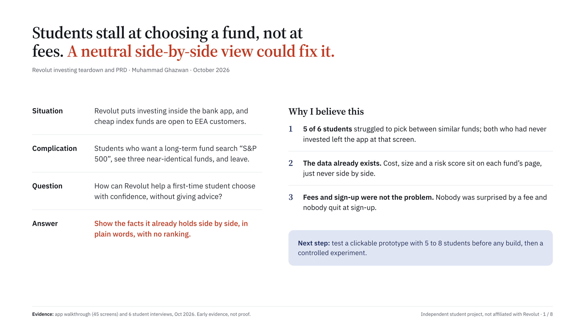
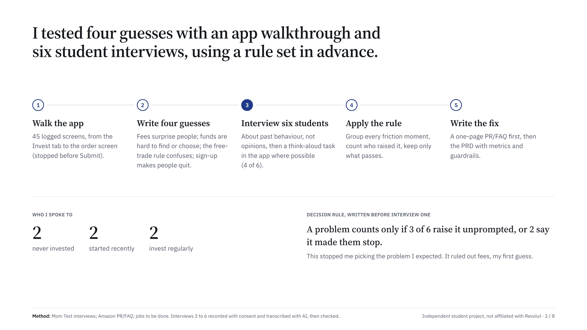
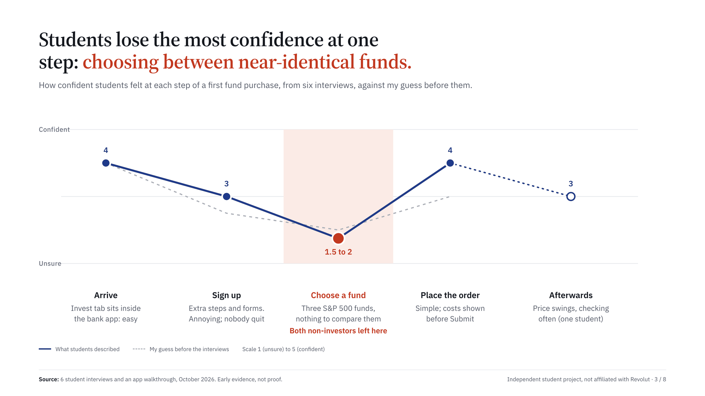
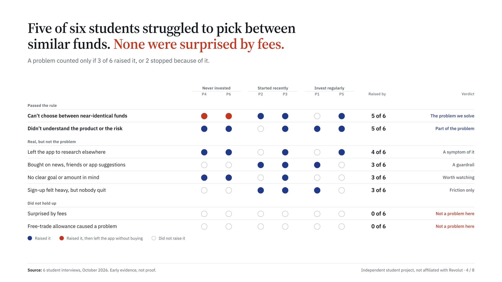
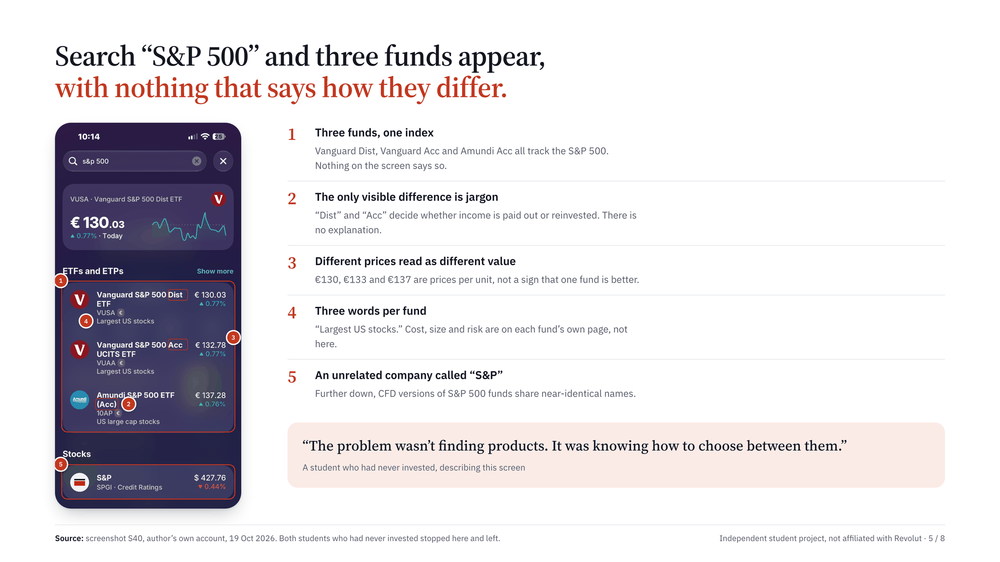
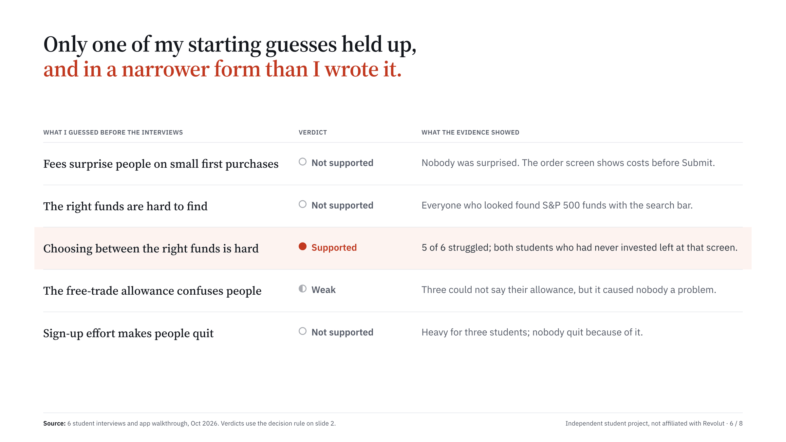
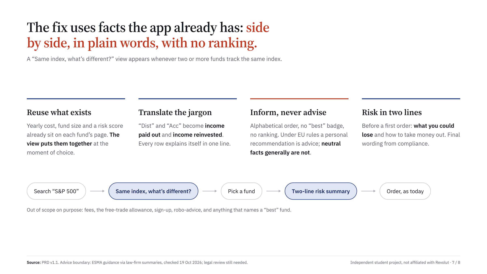
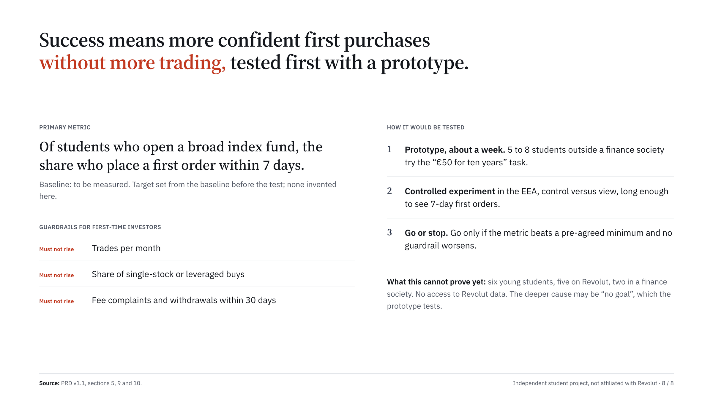

[← PRD](../05-prd/prd.md) · **Step 6 of 6: Deck** · [Overview](../README.md)

# The case in eight slides

Read it here, or [download the PDF](revolut-teardown-deck.pdf). Each title is the slide's conclusion, so the titles alone tell the story; the plan behind them is in the [storyline](storyline.md).

### 1. Executive summary

### 2. How I worked

Details: [brief](../01-scope/brief.md) · [interview guide](../03-research/interview-guide.md)

### 3. Where confidence drops

Details: [journey map](../02-teardown/journey-map.md)

### 4. What students said

Details: [synthesis](../03-research/synthesis.md)

### 5. The screen where they stalled

Details: [screenshots](../02-teardown/screenshots/)

### 6. My guesses versus the evidence

### 7. The proposal

Details: [PR/FAQ](../04-prfaq/prfaq.md) · [PRD](../05-prd/prd.md)

### 8. How success would be measured

Details: [PRD metrics](../05-prd/prd.md#5-success-metrics-g3-approved-oct-19) · [assumption map on Miro](https://miro.com/app/board/uXjVEYcX4L0=/?moveToWidget=3458764687766369806)

---

[← PRD](../05-prd/prd.md) · [Overview](../README.md)
