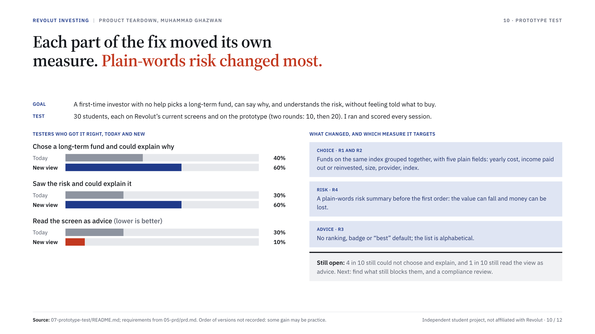

# Prototype test: does the proposed view help?

[← Deck](../06-deck/README.md) · **Step 7 of 7: Prototype test** · [Overview](../README.md)

After the PRD, I tested the proposal with 30 new people in two rounds: 10, then 20 a week later. This page records what I did and what I found. **Evidence label: Primary** (my own sessions, run in November 2026).

## Setup

| | |
| --- | --- |
| Who | 30 students from several universities, none of whom took part in the earlier six interviews |
| Rounds | Round 1: 10 people. Round 2: 20 more people, about a week later, with the same set-up |
| Experience | First-time investors who had never invested online and had never used Revolut |
| What they saw | Revolut's current fund screens ("old") and a prototype of the proposed view ("new": same-index grouping, plain-language fields, plain-words risk summary, no rankings or badges; requirements R1 to R4 in the [PRD](../05-prd/prd.md)) |
| Design | Every person saw both versions, so each result compares the same people on old and new |
| Privacy | Participants are anonymous. No names or personal data are recorded |

## Results

Round 1 counts (10 people), as I recorded them. Round 2 (20 people) gave the same percentages, so the combined result for all 30 is unchanged.

| What I measured | Round 1, old | Round 1, new | All 30, old | All 30, new |
| --- | --- | --- | --- | --- |
| Chose a long-term fund and could explain why | 4 of 10 | 6 of 10 | 40% | 60% |
| Saw the risk, understood it and could explain it | 3 of 10 | 6 of 10 | 30% | 60% |
| Read the screen as advice (a "claim" the app recommends a fund) | 3 of 10 | 1 of 10 | 30% | 10% |

## What I take from it

- The new view helped on all three measures, in the direction the PRD predicts, and the result held in a second, larger round.
- Risk comprehension changed most: it doubled, from 30% to 60%.
- 10% still read the new view as advice. The neutrality requirement (R3) is not yet proven and needs compliance review.
- 40% still could not choose and explain on the new view. The view helps but does not remove the stall.

## Limits, stated plainly

- Thirty people is early evidence, not proof. The gaps (20 to 30 points) are modest and the sample is small.
- This is a prototype, not a live product. It shows that people understand and choose better in a test, not that they will invest more. The PRD's success metric (first order within 7 days) still has no baseline and can only be measured by Revolut.
- Not recorded here: the order in which people saw old and new, session length, and the exact wording of the task. Seeing both versions in one session can make the second one easier, so some of the gain may be practice.
- Round 2 was added a week after round 1 and I did not write up its counts separately. The combined percentages are what I report.
- I ran and scored the sessions myself, so my own expectations may have shaped how answers were judged.
