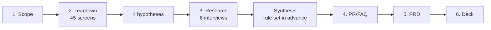
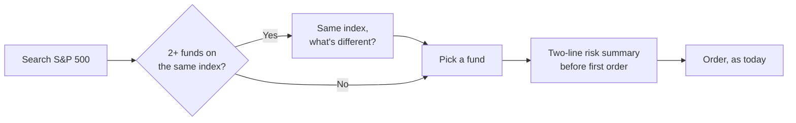

# Why students stall before their first index fund

**A product case study on Revolut's investing experience, by Muhammad Ghazwan** · BSc Economics and Business Economics (Finance), University of Amsterdam · October 2026

*Independent student project. Not affiliated with or endorsed by Revolut.*

> **In one sentence:** students who decide to invest for the long term find index funds easily, then stall because several near-identical funds appear with nothing explaining how they differ. I propose a neutral side-by-side view built from facts the app already holds.

| What I did | What I found | What I propose |
| --- | --- | --- |
| Walked through Revolut's investing flow on my own account (45 logged screens), interviewed 6 students, checked 3 competitors' official fee pages | 5 of 6 students struggled to choose between similar funds. Both who had never invested left the app at that screen. Nobody was surprised by fees. | A "Same index, what's different?" view and a two-line risk summary before a first order. No ranking, no advice. |

---

## Start here

The project follows a standard product discovery flow. Each step has its own folder, and every document links to the next one.

| Step | Read | What you will find | Time |
| --- | --- | --- | --- |
| 1. Scope | [Brief](01-scope/brief.md) · [Method](01-scope/research-method.md) | Who the project is for, four starting hypotheses, the evidence rules | 5 min |
| 2. Teardown | [Walkthrough log](02-teardown/teardown-log.md) · [Journey map](02-teardown/journey-map.md) · [Competitors](02-teardown/alternatives-comparison.md) · [Screenshots](02-teardown/screenshots/) | What the app actually shows, screen by screen | browse |
| 3. Research | [Interview guide](03-research/interview-guide.md) · [Synthesis](03-research/synthesis.md) | Six interviews, every friction moment counted against a rule set in advance | 10 min |
| 4. PR/FAQ | [PR/FAQ](04-prfaq/prfaq.md) | The fix written as if it had launched, with customer and internal FAQs | 5 min |
| 5. PRD | [PRD](05-prd/prd.md) | Problem, metrics and guardrails, prioritised requirements, risks | 15 min |
| 6. Deck | [8 slides](06-deck/) · [PDF](06-deck/revolut-teardown-deck.pdf) | The whole case in eight slides | 3 min |
| Research board | [Miro board](https://miro.com/app/board/uXjVEYcX4L0=/) | The working wall: snapshots, synthesis, opportunity tree, assumption map | browse |

---

## The case in four pictures

### 1. Students lose confidence at one moment

Before the interviews I expected fees and sign-up to hurt most (dashed line). The interviews moved the low point to one step: choosing between funds. Full map: [journey map](02-teardown/journey-map.md).

### 2. What six students told me

I wrote the decision rule before the first interview: an issue counts only if 3 of 6 raise it, or 2 stop because of it. Only fund choice passed both tests. Every count is traceable in the [synthesis](03-research/synthesis.md).

> "The problem wasn't finding products. It was knowing how to choose between them." (a student who had never invested)

### 3. The screen where they stalled

I captured this screen after the interviews to check what students described. The app already shows cost, size and a risk score on each fund's own page; the gap is that a student has to open every fund and compare in their head. Raw screens: [screenshots](02-teardown/screenshots/).

### 4. The proposal

When two or more funds track the same index, a **"Same index, what's different?"** view puts them side by side:

- **Reuses facts the app already has:** yearly cost, fund size and risk score, together at the moment of choice.
- **Translates the jargon:** "Dist" and "Acc" become "income paid out" and "income reinvested".
- **Informs, never advises:** alphabetical order, no "best" badge, no ranking. Under EU rules a personal recommendation is advice; neutral facts generally are not.
- **Shows risk in two lines:** before a first order, what you could lose and how to take money out.

**Success metric:** of students who open a broad index fund, the share who place a first order within 7 days. **Guardrails:** first-timers must not trade more often or buy riskier products as a result. Baselines are "to be measured": I have no access to Revolut's data. Details in the [PRD](05-prd/prd.md).

---

## Decisions I made

The project ran through three decision gates (G1 to G3) plus a few method calls. Each was mine, made on the evidence available at the time.

| Date | Decision | Why |
| --- | --- | --- |
| Oct 18 | **G1 Scope:** one journey only, from the Invest tab to a first purchase a first-timer feels confident about | Deep enough to show real product thinking in a week; a whole-app teardown would stay shallow |
| Oct 18 | Walked the app on my own account and logged every screen before any interview | To form hypotheses from the product, not from opinions |
| Oct 18 | Kept a strict decision rule, written before the first interview | To stop myself picking the problem I expected |
| Oct 19 | Recruited across three segments and ran six interviews; recorded interviews 3 to 6 with consent | Comparable stories from each stage; recording let me focus on the person instead of my notes |
| Oct 19 | **G1 amended:** narrowed the user to students | All six interviewees were students; a narrower user gives a sharper PRD |
| Oct 19 | Captured the S&P 500 search screen after the interviews | To check what students described against what the app really shows |
| Oct 19 | **G2 Problem:** chose fund choice, option 1 of 4 in the [synthesis](03-research/synthesis.md#6-options-considered-for-g2) | It passed both tests of the rule; fees, allowance and sign-up did not |
| Oct 19 | **G3 Metric and non-goals:** 7-day first-order rate with guardrails; no fixes to fees or sign-up, no "best fund" | Measures the outcome students need, and protects them from being pushed to trade |
| Oct 19 | Kept the proposal as principles, not a mock-up | The evidence supports the problem; a design should come out of a prototype test |

## What I got wrong, and changed

| My starting guess | What the evidence said |
| --- | --- |
| Fees surprise first-timers | Not supported: nobody was surprised; costs show before Submit |
| The right funds are hard to find | Not supported: everyone found them with search |
| Choosing is hard | **Supported, and narrower than I wrote it:** choosing between near-identical funds |
| Sign-up makes people quit | Not supported: annoying for some, nobody quit |

---

## The research board (Miro)

The deck shows the conclusions; the [Miro board](https://miro.com/app/board/uXjVEYcX4L0=/) shows the working behind them. It opens in view-only mode, no account needed.

| Frame | What it is |
| --- | --- |
| [1. Journey map](https://miro.com/app/board/uXjVEYcX4L0=/?moveToWidget=3458764687765872141) | Confidence at each step, with one student note per step |
| [2. Interview synthesis](https://miro.com/app/board/uXjVEYcX4L0=/?moveToWidget=3458764687765872717) | Every friction note grouped, counted and tested against the rule |
| [3. Interview snapshots](https://miro.com/app/board/uXjVEYcX4L0=/?moveToWidget=3458764687766248737) | One card per student in Teresa Torres's snapshot format |
| [4. Opportunity solution tree](https://miro.com/app/board/uXjVEYcX4L0=/?moveToWidget=3458764687766336443) | The outcome, the needs students voiced, solution ideas (including one I rejected) and the tests behind them |
| [5. Assumption map and test plan](https://miro.com/app/board/uXjVEYcX4L0=/?moveToWidget=3458764687766369806) | What is proven, what must be tested first, and what would make me stop |

## How I worked

- **Working backwards:** a one-page press release and FAQ before the requirements, as Amazon product teams do.
- **Interviews about what people did,** not what they think they would do (the Mom Test approach).
- **Jobs to be done:** the problem is written as "When ___, I want to ___, so I can ___."
- **Every claim labelled** Primary (my walkthrough and interviews) or Secondary (public sources, with the date checked). All sources: [sources.md](sources.md).

## Limits, stated plainly

- Six students is early evidence, not proof. All were young; two were in a university finance society.
- Interviews 1 and 2 were typed notes; interviews 3 to 6 were voice-recorded with consent, transcribed with an AI tool and checked by me against the audio.
- No access to Revolut data: targets are proposals and baselines are "to be measured".
- No names, balances or personal data appear anywhere in this repository. Interview notes stay private.
