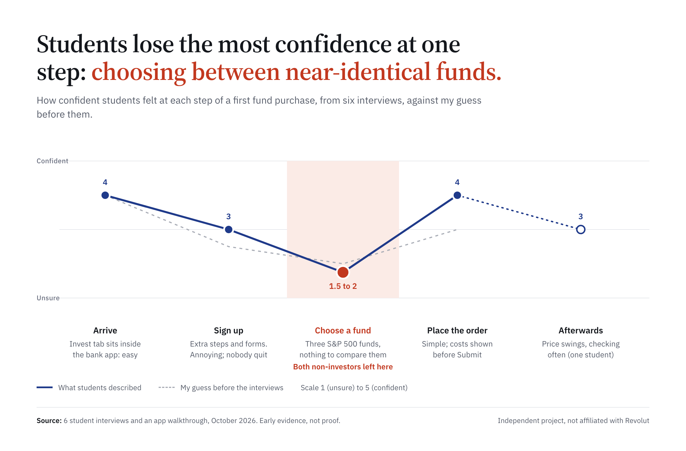
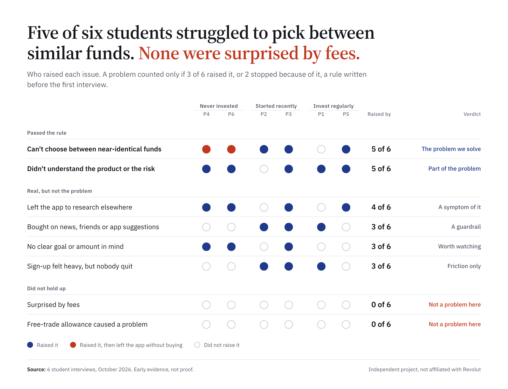
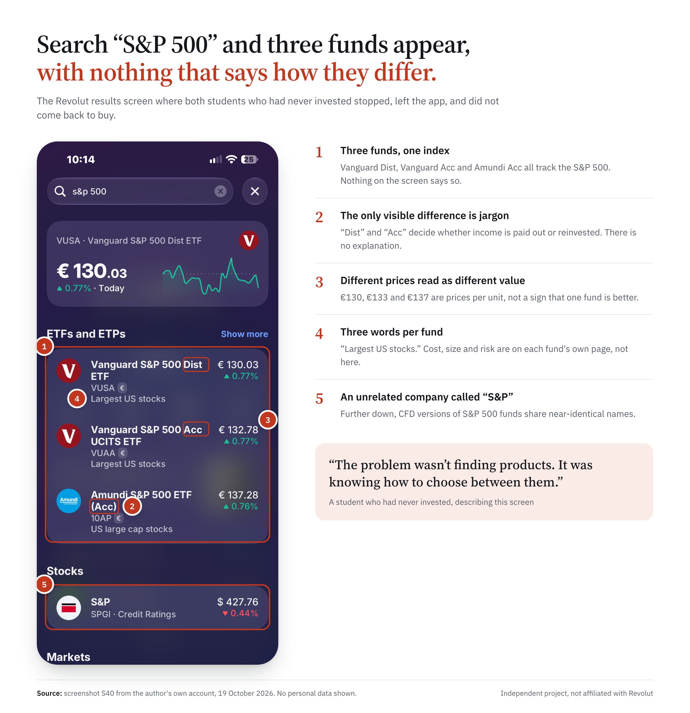
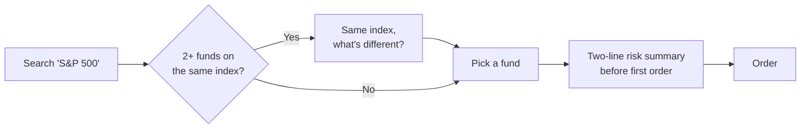
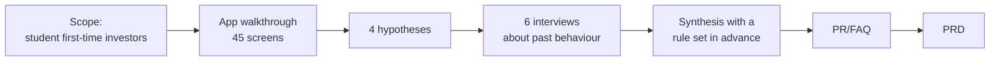

# Why students stall before their first index fund: a Revolut investing teardown

**A product case study by Muhammad Ghazwan** (BSc Economics and Business Economics, Finance track, University of Amsterdam). October 2026. Independent student project, not affiliated with or endorsed by Revolut.

> **In one sentence:** students who want to invest for the long term find the right kind of fund easily, then stall because three near-identical funds appear with nothing explaining how they differ. I propose a neutral side-by-side view that uses facts the app already holds.

| What I did | What I found | What I propose |
| --- | --- | --- |
| Walked through Revolut's investing flow (45 screens), interviewed 6 students, compared 3 competitors | 5 of 6 students struggled to choose between similar funds. Both who had never invested left the app at that screen. Nobody was surprised by fees. | A "Same index, what's different?" view and a two-line risk summary. No ranking, no advice. |

---

## 1. The moment students lose confidence

My guess before the interviews was that fees and sign-up would hurt most. The interviews said otherwise: confidence drops at one step, choosing a fund.

## 2. What six students told me

I set the rule before any interview: an issue counts only if 3 of 6 raise it, or 2 stop because of it. Only fund choice passed both tests. Fees, the free-trade allowance and sign-up did not.

> "The problem wasn't finding products. It was knowing how to choose between them." (student who had never invested)

## 3. The screen where they stalled

The app already shows cost, size and a risk score on each fund's own page. The gap is that you have to open every fund and compare in your head.

## 4. The proposal

When two or more funds track the same index, a **"Same index, what's different?"** view puts them side by side:

- **Uses facts the app already has.** Yearly cost, fund size and risk score already sit on each fund's own page. The view puts them together at the moment of choice.
- **Explains the jargon in one line.** "Dist" and "Acc" become "income paid out" and "income reinvested".
- **Information, not advice.** Alphabetical order, no "best" badge, no ranking. Under EU rules, a personal recommendation counts as advice; neutral facts generally do not.
- **Risk in two lines.** Before a first order: what you could lose, and how to take money out.

**How success would be measured:** of students who open a broad index fund, the share who place a first order within 7 days. **Guardrails:** first-timers must not trade more often or buy riskier products as a result. All baselines are "to be measured", because I have no access to Revolut's data.

## How I worked

- **Working backwards:** a one-page press release and FAQ before the requirements, as Amazon product teams do.
- **Interviews about what people did,** not what they think they would do (the "Mom Test" approach).
- **Every claim labelled** Primary (my walkthrough and interviews) or Secondary (public sources, with the date checked).

## What I got wrong, and changed

| My starting guess | What the evidence said |
| --- | --- |
| Fees surprise first-timers | Not supported: nobody was surprised; costs show before Submit |
| The right funds are hard to find | Not supported: everyone found them with search |
| Choosing is hard | **Supported, and narrower than I thought:** choosing between near-identical funds |
| Sign-up makes people quit | Not supported: annoying for some, nobody quit |

## Read the full work

| Document | What it is | Time to read |
| --- | --- | --- |
| [PR/FAQ](04-prfaq/) | One-page press release and FAQ | 5 min |
| [PRD](05-prd/) | Problem, evidence, metrics, requirements, risks | 15 min |
| [Research](03-research/) | Interview guide and synthesis (anonymised) | 10 min |
| [Teardown](02-teardown/) | Screen-by-screen log, journey map, competitors | browse |
| [Deck](06-deck/) | 8-slide summary, viewable on GitHub or as a PDF | 3 min |

## Limits, stated plainly

- Six students is early evidence, not proof. All were young; two were in a university finance society.
- Interviews 3 to 6 were voice-recorded with consent and transcribed with an AI tool, then checked by me.
- No access to Revolut data: targets are proposals, baselines are "to be measured".
- No names, balances or personal data appear anywhere in this repository.
