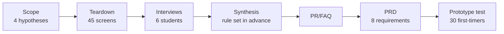
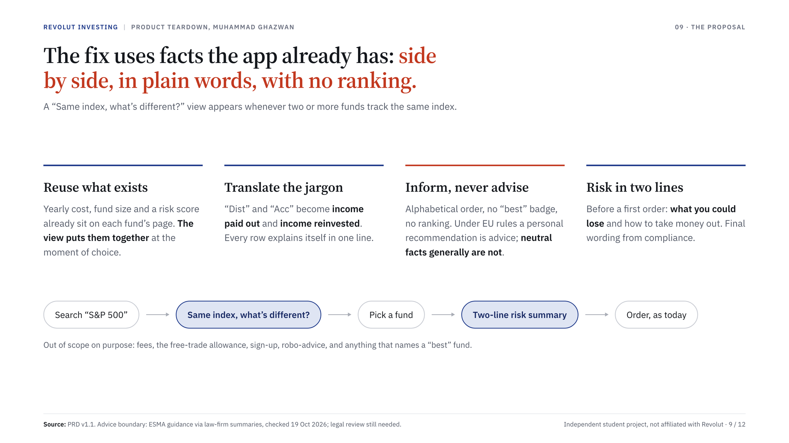
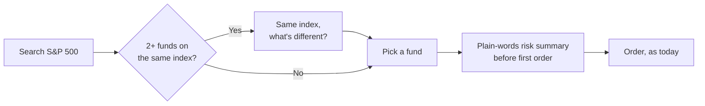

# Why students stall before their first index fund

**A product case study on Revolut's investing experience, by Muhammad Ghazwan** · BSc Economics and Business Economics (Finance), University of Amsterdam · October to November 2026

*Independent student project. Not affiliated with or endorsed by Revolut.*

![Overview. Students stall at choosing a fund, not at fees. A neutral side-by-side view helped them choose. The question: how can Revolut help a first-time student choose with confidence, without giving advice? My answer in three parts: group funds that track the same index; explain each difference and the risk in plain words; never rank. Results from a 30-person test, today versus the new view: chose a fund and could say why 40% to 60%; understood the risk 30% to 60%; read the screen as advice 30% to 10%. Next step: help the 40% still stuck, then a controlled experiment.](06-deck/slides/slide-01-overview.png)

**Students who decide to invest for the long term find index funds easily, then stall because several near-identical funds appear with nothing explaining how they differ.**

**In 30 seconds**
- **The problem:** searching "S&P 500" in Revolut shows three funds that track the same index, with nothing saying how they differ. 5 of 6 students I interviewed struggled at that screen; both who had never invested left the app there.
- **My call:** a neutral "Same index, what's different?" view built from facts the app already holds, plus a plain-words risk summary before a first order. No ranking, no "best", no advice.
- **The result:** in a prototype test with 30 first-time investors, each on today's screens and the new view, **confident choices rose from 40% to 60%**, **risk understanding doubled from 30% to 60%**, and **reading the screen as advice fell from 30% to 10%**. [Full results](07-prototype-test/README.md)
- **The proof:** 4 hypotheses and a decision rule written before any interview, 45 logged app screens, 6 interviews, a PRD with 8 requirements, and the test above. Fees, my own first guess, did not hold up.

**My role:** I ran every step myself: walkthrough, interviews, synthesis, PR/FAQ, PRD, prototype test and deck. AI tools helped me structure documents, transcribe interviews 3 to 6 (checked by me against the audio) and build the visuals; every decision and every count is mine.

**What this shows for product and strategy roles**
- **Problem framing:** narrowed "investing in Revolut" to one journey and one moment that carries the risk.
- **Evidence over opinion:** a decision rule set in advance, which ruled out my own first hypothesis.
- **Product thinking under regulation:** a fix that informs without advising, checked against EU advice rules.
- **Measuring outcomes, including what's still open:** a 30-person test that shows the gain and the 40% still stuck.
- **Communication:** a 12-slide deck where each title is the conclusion, and every number names its source.

**Jump to:** [The problem](#the-problem) · [How I worked](#how-i-worked) · [What students said](#what-students-said) · [The proposal](#the-proposal) · [The prototype test](#the-prototype-test) · [What comes next](#what-comes-next) · [Decisions](#decisions-i-made) · [What I learned](#what-i-learned) · [All the docs](#all-the-docs)

**Read by role**

| You are | Read | Time |
| --- | --- | --- |
| Anyone | "In 30 seconds", the two slides above, then [the 12-slide deck](06-deck/) | 5 min |
| Product or strategy | [The problem](#the-problem) → [synthesis](03-research/synthesis.md) → [PR/FAQ](04-prfaq/prfaq.md) → [PRD](05-prd/prd.md) → [prototype test](07-prototype-test/README.md) | 20 min |
| Research or UX | [Interview guide](03-research/interview-guide.md) → [synthesis](03-research/synthesis.md) → [journey map](02-teardown/journey-map.md) → [Miro board](https://miro.com/app/board/uXjVEYcX4L0=/) | 15 min |
| Finance or operations | [Competitor fees](02-teardown/alternatives-comparison.md) → [PRD risks and regulation](05-prd/prd.md#11-risks-and-regulatory-notes) → [limits](#limits-stated-plainly) | 10 min |

---

## The problem

Revolut puts investing inside the bank app, and cheap index funds are open to EEA customers. A student who decides to invest for the long term searches "S&P 500" and finds three funds that track the same index. The app shows cost, size and a risk score on each fund's own page, but never side by side, so a first-timer has to open each one and compare in their head.

> "The problem wasn't finding products. It was knowing how to choose between them." (a student who had never invested)

## How I worked

1. **Scope first.** One journey only: from the Invest tab to a first purchase a first-timer feels confident about. [Brief](01-scope/brief.md)
2. **Look before asking.** I walked the app on my own account and logged 45 screens, then checked 3 competitors' official fee pages. [Teardown log](02-teardown/teardown-log.md) · [Competitors](02-teardown/alternatives-comparison.md)
3. **Write the bar down.** Four hypotheses, and a rule written before the first interview: an issue counts only if 3 of 6 raise it, or 2 stop because of it. [Method](01-scope/research-method.md)
4. **Listen to behaviour.** Six interviews about what people did, not what they would do (the Mom Test approach). [Interview guide](03-research/interview-guide.md)
5. **Work backwards.** A one-page PR/FAQ before the PRD, as Amazon product teams do. [PR/FAQ](04-prfaq/prfaq.md)
6. **Test before building.** A prototype test with 30 new first-time investors, today's screens against the new view. [Prototype test](07-prototype-test/README.md)

Every claim is labelled Primary (my walkthrough, interviews and test) or Secondary (public sources, with the date checked). All sources: [sources.md](sources.md).

## What students said

Only fund choice passed both tests of the rule. Every count is traceable in the [synthesis](03-research/synthesis.md).

## The proposal

When two or more funds track the same index, a **"Same index, what's different?"** view puts them side by side.

The full requirements (R1 to R8), each with a pass test: [PRD](05-prd/prd.md#7-requirements).

## The prototype test

I tested the proposal with 30 students from several universities who had never invested online or used Revolut, none of them from the interviews. Each did the same task on Revolut's current screens and on a prototype of the new view, in two rounds (10, then 20 a week later).

| What I measured | Today's screens | New view |
| --- | --- | --- |
| Chose a long-term fund and could explain why | 40% | **60%** |
| Saw the risk and could explain it | 30% | **60%** |
| Read the screen as advice (lower is better) | 30% | **10%** |

**Still open:** 40% still could not choose and explain, and 10% still read the view as advice. Setup, results and limits: [07-prototype-test](07-prototype-test/README.md).

## What comes next

Baselines are "to be measured": I have no access to Revolut's data. Details in the [PRD](05-prd/prd.md#5-success-metrics-g3-approved-oct-19).

---

## Decisions I made

The project ran through three decision gates (G1 to G3) plus a few method calls. Each was mine, made on the evidence available at the time.

| Date | Decision | Why |
| --- | --- | --- |
| Oct 18 | **G1 Scope:** one journey only, from the Invest tab to a first purchase a first-timer feels confident about | Deep enough to show real product thinking in a week; a whole-app teardown would stay shallow |
| Oct 18 | Walked the app on my own account and logged every screen before any interview | To form hypotheses from the product, not from opinions |
| Oct 18 | Kept a strict decision rule, written before the first interview | To stop myself picking the problem I expected |
| Oct 19 | Recruited across three segments and ran six interviews; recorded interviews 3 to 6 with consent | Comparable stories from each stage; recording let me focus on the person instead of my notes |
| Oct 19 | **G1 amended:** narrowed the user to students | All six interviewees were students; a narrower user gives a sharper PRD |
| Oct 19 | Captured the S&P 500 search screen after the interviews | To check what students described against what the app really shows |
| Oct 19 | **G2 Problem:** chose fund choice, option 1 of 4 in the [synthesis](03-research/synthesis.md#6-options-considered-for-g2) | It passed both tests of the rule; fees, allowance and sign-up did not |
| Oct 19 | **G3 Metric and non-goals:** 7-day first-order rate with guardrails; no fixes to fees or sign-up, no "best fund" | Measures the outcome students need, and protects them from being pushed to trade |
| Nov 2026 | Tested a prototype with 30 new first-time investors, each on both versions | To check the proposal with people before anyone builds it |

## What I learned

| My starting guess | What the evidence said |
| --- | --- |
| Fees surprise first-timers | Not supported: nobody was surprised; costs show before Submit |
| The right funds are hard to find | Not supported: everyone found them with search |
| Choosing is hard | **Supported, and narrower than I wrote it:** choosing between near-identical funds |
| Sign-up makes people quit | Not supported: annoying for some, nobody quit |

## The research board (Miro)

The deck shows the conclusions; the [Miro board](https://miro.com/app/board/uXjVEYcX4L0=/) shows the working behind them. It opens in view-only mode, no account needed.

| Frame | What it is |
| --- | --- |
| [1. Journey map](https://miro.com/app/board/uXjVEYcX4L0=/?moveToWidget=3458764687765872141) | Confidence at each step, with one student note per step |
| [2. Interview synthesis](https://miro.com/app/board/uXjVEYcX4L0=/?moveToWidget=3458764687765872717) | Every friction note grouped, counted and tested against the rule |
| [3. Interview snapshots](https://miro.com/app/board/uXjVEYcX4L0=/?moveToWidget=3458764687766248737) | One card per student in Teresa Torres's snapshot format |
| [4. Opportunity solution tree](https://miro.com/app/board/uXjVEYcX4L0=/?moveToWidget=3458764687766336443) | The outcome, the needs students voiced, solution ideas (including one I rejected) and the tests behind them |
| [5. Assumption map and test plan](https://miro.com/app/board/uXjVEYcX4L0=/?moveToWidget=3458764687766369806) | What is proven, what must be tested first, and what would make me stop |

## Limits, stated plainly

- Six interviews and 30 testers are early evidence, not proof. All were young students; two interviewees were in a university finance society.
- Interviews 1 and 2 were typed notes; interviews 3 to 6 were voice-recorded with consent, transcribed with an AI tool and checked by me against the audio.
- In the prototype test, everyone saw both versions in one session, so some of the gain may be practice. I ran and scored every session myself. Round 2 counts were not written up separately. Details in [07-prototype-test](07-prototype-test/README.md).
- No access to Revolut data: targets are proposals and baselines are "to be measured".
- No names, balances or personal data appear anywhere in this repository. Interview notes stay private.

## All the docs

In reading order. Each folder opens with a line on what it shows.

| Step | Read | What you will find | Time |
| --- | --- | --- | --- |
| 1. Scope | [Brief](01-scope/brief.md) · [Method](01-scope/research-method.md) | Who the project is for, four starting hypotheses, the evidence rules | 5 min |
| 2. Teardown | [Walkthrough log](02-teardown/teardown-log.md) · [Journey map](02-teardown/journey-map.md) · [Competitors](02-teardown/alternatives-comparison.md) · [Screenshots](02-teardown/screenshots/) | What the app actually shows, screen by screen | browse |
| 3. Research | [Interview guide](03-research/interview-guide.md) · [Synthesis](03-research/synthesis.md) | Six interviews, every friction moment counted against a rule set in advance | 10 min |
| 4. PR/FAQ | [PR/FAQ](04-prfaq/prfaq.md) | The fix written as if it had launched, with customer and internal FAQs | 5 min |
| 5. PRD | [PRD](05-prd/prd.md) | Problem, metrics and guardrails, prioritised requirements, risks | 15 min |
| 6. Deck | [12 slides](06-deck/) · [PDF](06-deck/revolut-teardown-deck.pdf) | The whole case, results first | 5 min |
| 7. Prototype test | [Results](07-prototype-test/README.md) | The proposal tested with 30 first-time investors, today's screens versus new | 3 min |
| Research board | [Miro board](https://miro.com/app/board/uXjVEYcX4L0=/) | The working wall: snapshots, synthesis, opportunity tree, assumption map | browse |
